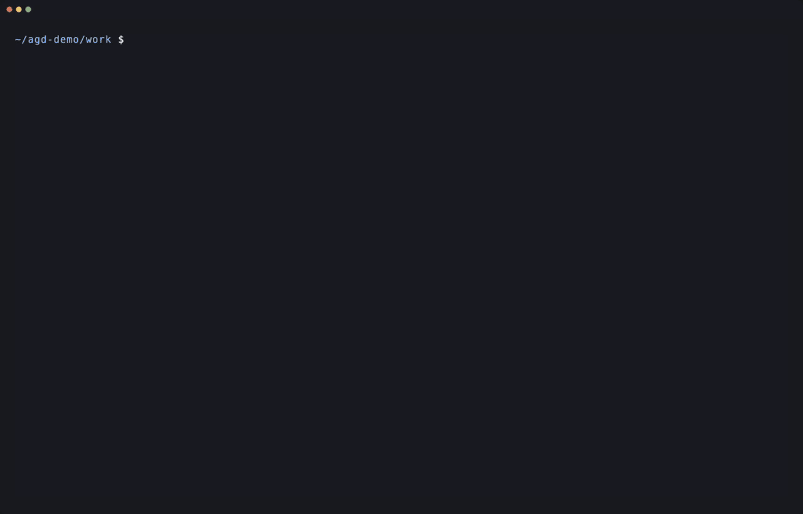

# agd

[](https://github.com/johnnybravo-xyz/agd/actions/workflows/ci.yml)
[](https://crates.io/crates/agd)
[](https://github.com/johnnybravo-xyz/agd/blob/main/LICENSE)

**A local-first Org agenda for terminals and coding agents.**

`agd` reads the Org files and settings you already use with Emacs or
nvim-orgmode and shows the same tasks everywhere: a keyboard-first TUI, a
narrow pane, the command line, coding agents over MCP, and panels in Claude
Code and Herdr. Org files stay the source of truth, and nothing leaves your
machine.



## Why agd

- **Keep your workflow.** Import agenda files, TODO sequences, capture
  templates, logging, priorities and custom views from Emacs or nvim-orgmode.
- **One agenda, every surface.** Plan in the TUI, glance from a pane, script the
  CLI, let agents work through MCP. Each says the same thing the same way.
- **Your files stay yours.** Writes touch only the intended bytes, refuse stale
  or ambiguous targets, and are journaled for undo.
- **Org, deliberately.** Agenda output and edits are checked byte for byte
  against pinned Emacs 30.2 and Org 9.7.
- **Local only.** The MCP server speaks stdio and opens no port.

## Install

Choose one:

```bash
cargo install agd --locked                  # Cargo; Rust 1.89+
brew install johnnybravo-xyz/agd/agd        # Homebrew
nix profile add github:johnnybravo-xyz/agd  # Nix
```

Signed builds for Linux, macOS and Windows are on
[GitHub Releases](https://github.com/johnnybravo-xyz/agd/releases/latest); Arch
users can build the
[AUR package](https://github.com/johnnybravo-xyz/agd/tree/main/packaging/aur).

## Quick start

```bash
agd setup import ~/.doom.d     # or ~/.emacs.d, ~/.config/emacs, ~/.config/nvim
agd                            # the TUI
```

New to Org? No config is needed:

```bash
mkdir -p ~/org
agd capture "Renew passport due:fri #personal !A"
agd
```

## Every surface

| Surface | Start it | For |
| --- | --- | --- |
| TUI | `agd` | Today, Week, Inbox, saved views, Find, Triage, agent review |
| Pane | `agd --pane` | A narrow glance in a tmux split |
| CLI | `agd agenda`, `agd query`, `agd capture`, `agd edit`, `agd undo` | Scripts and status bars, text or JSON |
| MCP | `agd mcp` | Coding agents, over stdio |
| Claude Code | `/agd`, `/capture`, a status band | Your agenda beside the chat |
| Herdr | a docked panel | Today with Done and Undo |

`u` in the TUI and `agd undo` take back your latest change from any of them.
Agent changes wait on the Agents tab for review.

## Connect agents

```bash
agd setup install --dry-run --detected   # preview detected integrations
agd setup install --detected
```

Or install one explicitly: `codex`, `opencode`, `pi`, `omp`, `copilot` (VS
Code and the Copilot CLI) or `herdr`. Claude Code uses the plugin:

```bash
claude plugin marketplace add johnnybravo-xyz/agd
claude plugin install agd@johnnybravo-xyz
```

Any other stdio client runs command `agd` with argument `mcp`.

## Script it

The agenda, query, capture, edit and undo commands support `--json`. Use it
instead of parsing terminal text: versioned schemas expose dates, counts and
agd's own display wording. Mutations return the current `ref`, so agd can
recheck the target before the next edit writes. `jq` is optional and used only
in these examples:

```bash
agd agenda --span day --json | jq -r '.[] | "\(.display.lead)\t\(.display.title)"'
agd query '(todo)' --json | jq 'group_by(.category) | map({(.[0].category): length}) | add'

ref=$(agd capture --json "Call the bank on:fri" | jq -r '.item.ref')
agd edit "$ref" --add-tag finance
```

## Documentation

- [Getting started](https://github.com/johnnybravo-xyz/agd/blob/main/docs/getting-started.md):
  setup, daily use, scripting and agents
- [Reference](https://github.com/johnnybravo-xyz/agd/blob/main/docs/reference.md):
  import, compatibility, write safety and troubleshooting
- [Keys](https://github.com/johnnybravo-xyz/agd/blob/main/docs/KEYS.md),
  [architecture](https://github.com/johnnybravo-xyz/agd/blob/main/ARCHITECTURE.md),
  [contributing](https://github.com/johnnybravo-xyz/agd/blob/main/CONTRIBUTING.md),
  [security](https://github.com/johnnybravo-xyz/agd/blob/main/SECURITY.md)
- Changelogs: [agd](https://github.com/johnnybravo-xyz/agd/blob/main/agd/CHANGELOG.md),
  [agd-core](https://github.com/johnnybravo-xyz/agd/blob/main/agd-core/CHANGELOG.md)

## Development and license

`just check` runs formatting, Clippy, the tests, the Claude Code plugin checks
and `nix flake check`; `just oracles` compares agd with pinned Emacs and Neovim
in Docker.

`agd` began as a fork of
[`szaffarano/org-mcp-server`](https://github.com/szaffarano/org-mcp-server). The
combined work is licensed under GPL-3.0-or-later; upstream-derived code is also
available under the
[MIT license](https://github.com/johnnybravo-xyz/agd/blob/main/LICENSE-MIT).
