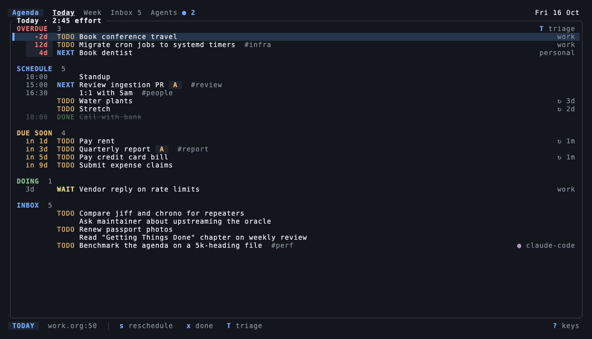

# Agenda (`agd`)

[](https://github.com/johnnybravo-xyz/agd/actions/workflows/ci.yml)
[](https://crates.io/crates/agd)
[](LICENSE)

An org-agenda for the terminal and for coding agents. `agd` reads the Org
files and settings you already use with Emacs or nvim-orgmode, shows them in a
keyboard-first TUI, and lets agents read and write the same tasks over MCP,
without changing a byte it was not asked to change.



- **Your setup keeps working.** `#+TODO` lines, keyword logging markers,
  `#+STARTUP` options, custom agenda commands, capture templates, sorting
  strategy and tag columns are honored, not reinterpreted. Agenda rows, their
  order and every write are checked against a pinned Emacs.
- **Built for the five moments you use an agenda:** a glance in a split pane,
  the morning plan in Today, an end-of-day Triage, a one-line Capture from
  anywhere, and Agent review of what coding agents changed.
- **Safe with your data.** Writes patch only the bytes they mean to, refuse
  stale or ambiguous targets, respect Emacs lock files, and can be undone.

Try it on sample data without touching your files:

```bash
git clone https://github.com/johnnybravo-xyz/agd.git && cd agd
cargo build --release && AGD=target/release/agd docs/demo/demo.sh
```

## Install

```bash
cargo install agd --locked                 # Rust 1.89+
brew install johnnybravo-xyz/agd/agd
nix run github:johnnybravo-xyz/agd
```

Tagged releases publish checksummed binaries for Linux, macOS and Windows with
a Sigstore bundle for `SHA256SUMS`. The Arch recipe is in
[`packaging/aur`](packaging/aur).

## First run

Tell `agd` where your Org files live, bring in your editor's settings, and
check the files before the first write:

```bash
mkdir -p ~/.config/agd
printf '[files]\nroots = ["~/org"]\n' > ~/.config/agd/config.toml
agd setup import emacs --verify          # from a running daemon (--server NAME)
agd setup import nvim --verify           # or from nvim-orgmode
agd setup check
agd
```

The import asks your running editor for its resolved settings (agenda files,
TODO sequences, logging, priorities, capture templates, custom agenda
commands) and stores them in `~/.config/agd/imports/`. `--verify` runs every
imported view in Emacs and in `agd` and reports where rows differ. See
[`docs/IMPORTING.md`](docs/IMPORTING.md).

## The TUI

`agd` opens **Today**. Tabs switch to **Week**, **Inbox** and **Agents**
(`tab` or `1`–`4`); `a` opens your saved views like `C-c a`.

| Screen | What it is for |
| --- | --- |
| Today | Sections in the order you act: SLIPPED (three rows; the rest wait in Triage), SCHEDULE by clock time, DUE SOON with countdowns, DOING with WAIT ages, INBOX with who captured each item. `v` swaps in the classic org-agenda day list; `p` peeks at the item. |
| Triage (`T`) | Overdue, then inbox, one card at a time: `.` today, `m` tomorrow, `w` next week, `p` pick a date, `x` done, `n` NEXT, `s` someday, `k` cancel, `r` refile. Cards show how long an item slipped and how often it was rescheduled, and suggest Someday after three. `u` undoes a step, or the whole pass at the end. |
| Capture (`c`) | One line with `due:fri on:+2d +tag #A`; the first letter picks a template, `%^{prompt}` fields get their own line, and the preview is the exact Org text that will be written. `ctrl-e` writes the body in `$EDITOR`. |
| Agent review (`A`) | Every agent write with who made it, from which project, and its smallest meaningful diff. `a` accepts (writes nothing), `u` undoes it if those bytes are unchanged, `d` shows the raw diff, `f` filters by agent. |
| Pane (`--pane`) | A 32-column glance: slipped collapsed to a count, timed items by clock with `▸` on the next one, done items dimmed, inbox and agent counts. It also takes over automatically under 60 columns. |

Keys follow org-agenda wherever it has one, so muscle memory carries over:

| Key | Action | org-agenda |
| --- | --- | --- |
| `j` / `k` | move | `n` / `p` |
| `⏎` / `e` | open in `$EDITOR` at the heading | `RET` |
| `t` / `x` | cycle TODO state / mark done | `t` |
| `s` / `d` | schedule / deadline (`fri`, `+2d`, `2026-10-30 14:00`) | `C-c C-s` / `C-c C-d` |
| `,` `+` `-` | priority | `,` `+` `-` |
| `:` / `r` | tags / refile | `:` / `C-c C-w` |
| `f` `b` `.` | next, previous, today | `f` `b` `.` |
| `<` / `/` | context filter by category / filter by text or tag | `<` / `/` |
| `space` | mark; then `.` `m` `w` `s` act on all marks | `m`, `B` |
| `v` / `l` / `g` | classic layout / log mode / refresh | `v` / `l` / `g` |
| `u` | undo the last write | `C-_` |
| `y` | copy the item's link (OSC 52) | |
| `?` | all keys | `?` |

Colours carry state only (slipped, due, done, focus, one hue per agent). The
theme follows the terminal's light or dark background (`[tui] theme` overrides
it), falls back to 16 colours, and honours `NO_COLOR`.

## tmux and herdr

```bash
tmux split-window -h -l 36 'agd --pane'                 # a glance beside your agent
tmux bind c display-popup -E -w 80 -h 22 'agd capture -i' # capture from anywhere
set -g status-right '#(agd agenda --status)'            # 3 slipped · 7 today · 2 agents
set -g set-clipboard on                                 # lets `y` reach your clipboard
```

The pane and the TUI watch your files, so changes from Emacs, nvim or an agent
show up as they happen. herdr panes are mouse-native; click a row to select it,
click it again to open the full TUI there.

## Agents

`agd mcp` is a stdio MCP server with six tools (`agenda`, `query`, `capture`,
`set_state`, `plan`, `edit`) and an `agenda://today` resource. It never opens
a network port. Install it with the `agd` skill for your agent:

```bash
agd setup install --directory . claude      # or codex, opencode
agd setup install --directory . claude --with-session-agenda work
```

- Every agent write is journaled with the client's name and project, and shows
  up in Agent review until you accept or undo it.
- Agents pass `properties` such as `REPO`, `BRANCH` and `SOURCE` (an Org link
  back to the file and line) with a capture, so a task says where it came from.
- `agents.capture_to = "inbox"` sends every agent capture to your inbox
  without dates, so agents can add work but not plan your day.
- Session agenda is off by default; `--with-session-agenda` needs a named,
  filtered profile.

## Command line

```text
agd                 Today, Week, Inbox, Triage, Capture, Agent review
agd --pane          the narrow pane
agd agenda          the agenda as org-agenda prints it, or --json / --csv
agd capture         one line through a template, or the popup with -i
agd mcp             stdio MCP server for coding agents
agd setup import    Emacs or nvim-orgmode settings into a snapshot
agd setup install   MCP server and skill for Claude Code, Codex, OpenCode
agd setup check     parse drift, invalid UTF-8 and duplicate IDs
```

```bash
agd agenda --span week                       # org-agenda layout
agd agenda --view n                          # a saved view, like C-c a n
agd agenda --match 'work-someday/NEXT|TODO' --json
agd agenda --csv                             # the columns of org-batch-agenda-csv
agd capture t "Renew passport due:fri +personal #A" --dry-run
```

JSON items carry a stable `ref`: the heading's `:ID:` when unique, otherwise
file, line hint and content digest. Errors use stable codes such as
`stale_ref`, `duplicate_id`, `editor_dirty` and `symlink_write_refused`.

## Configuration

`~/.config/agd/config.toml` (or `$XDG_CONFIG_HOME/agd`) on Linux and macOS
alike; `--config` picks another file. The journal lives in
`~/.local/share/agd` (or `$XDG_DATA_HOME/agd`). Settings in this file override
the imported snapshot; unknown keys are errors.

```toml
[files]
roots = ["~/org"]                 # the only directories agd reads or writes
agenda = ["**/*.org"]             # usually comes from your editor import

[todo]
sequences = [["TODO(t)", "NEXT(n)", "WAIT(w@/!)", "|", "DONE(d!)", "CANCELLED(c@)"]]
ids = "preserve"                  # "add-on-write" adds an org-id :ID: on first edit

[agenda]
span = "week"
deadline_warning_days = 14
sorting_strategy = ["habit-down", "time-up", "urgency-down", "category-keep"]
log_done = "time"                 # org-log-done; also log_repeat, log_reschedule,
log_into_drawer = true            # log_redeadline; #+STARTUP options win per file

[tags]
column = -77                      # org-tags-column

[capture.t]
desc = "Todo"
file = "inbox.org"
heading = "Inbox"
template = "* TODO %?\n:PROPERTIES:\n:CREATED: %U\n:END:"

[views.w]                         # an org-agenda custom command
desc = "Work"
blocks = [
  { kind = "agenda", span = "day" },
  { kind = "tags-todo", match = "work/NEXT|WAIT", header = "Next and waiting" },
]

[editor]
command = "emacsclient"           # run directly, never through a shell
args = ["-n", "+{line}:{col}", "{file}"]

[agents]
capture_to = "template"           # or "inbox"

[triage]
someday_tag = "someday"
reschedule_nudge = 3

[tui]
theme = "auto"                    # dark, light
```

## Compatibility

Agenda rows and their order are compared with `org-batch-agenda-csv` from a
pinned Emacs 30.2 with Org 9.7; writes are compared byte for byte with what the
same Emacs writes. Full tables are in
[`docs/COMPATIBILITY.md`](docs/COMPATIBILITY.md).

| Area | Status |
| --- | --- |
| Scheduled, deadlines, warnings, past-scheduled and overdue reminders | Exact |
| `+`, `++`, `.+` and habit repeaters, ranges, headline timestamps | Exact |
| Default and configured `org-agenda-sorting-strategy` row order | Exact |
| Tag inheritance, `#+CATEGORY`, `#+FILETAGS`, Unicode tags and weekdays | Exact |
| Custom agenda commands: agenda, todo, alltodo, tags, tags-todo blocks | Exact rows; other options reported |
| State changes, CLOSED, repeats, LOGBOOK notes, reschedule logs, tag alignment | Byte-identical to Emacs |
| Property and regexp matches, diary sexps, skip functions, clocking | Not supported; reported, never evaluated |

## Safety

- Only files under `files.roots` are read or written; symlinks that leave the
  roots are refused, and writes never follow symlinks.
- A write re-reads the file under a lock, refuses Emacs's unsaved-buffer lock,
  patches only its bytes, preserves mode and line endings, journals the
  inverse patch with fsync, and renames atomically.
- Undo applies the inverse only where those bytes are unchanged; anything else
  is a conflict, never an overwrite.
- No network access at runtime. Editor import is an explicit local command.

Details: [`docs/SAFETY.md`](docs/SAFETY.md).

## Development

```bash
cargo fmt --all --check
cargo clippy --workspace --all-targets --all-features -- -D warnings
cargo test --workspace --all-targets --all-features
nix flake check
```

`agd/` is the executable (CLI, TUI, MCP), `org-core/` the `agd-core` library
(parsing, agenda, writes), and `conformance/` the Emacs and nvim-orgmode oracle
fixtures with their scripts in `scripts/`. `vhs docs/release/agd.tape` records
the GIF above from `docs/demo`.

## Origin and license

A fork of [`szaffarano/org-mcp-server`](https://github.com/szaffarano/org-mcp-server).
The combined work is GPL-3.0-or-later; upstream-derived code remains available
under its MIT license in [`LICENSE-MIT`](LICENSE-MIT).
