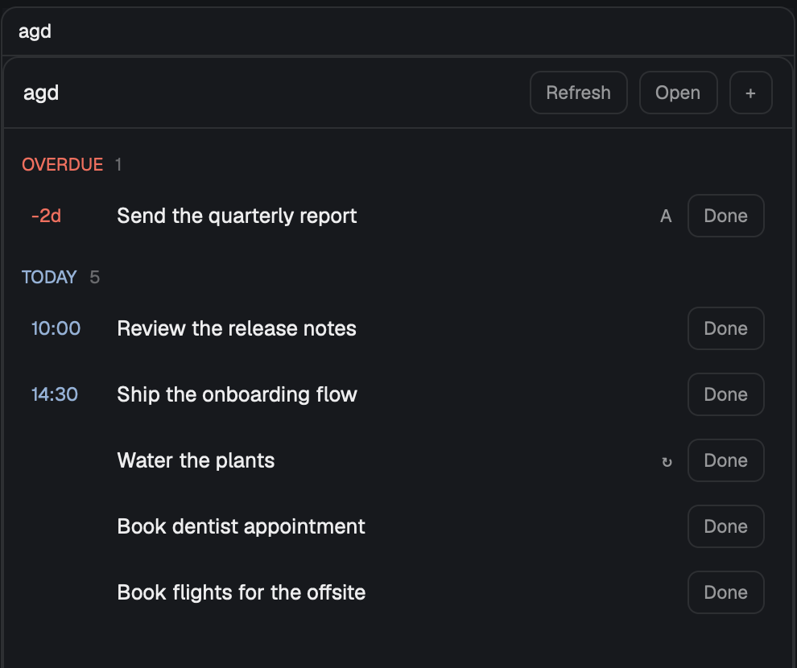
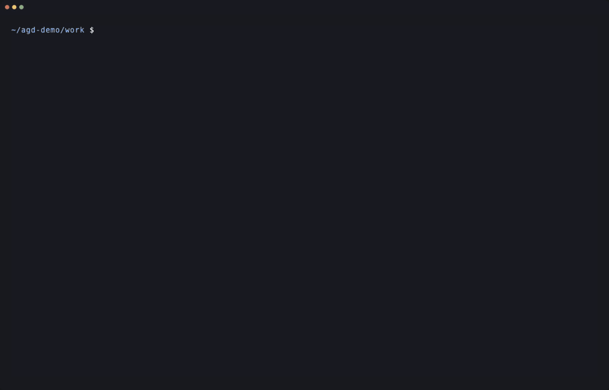

# agd agenda panel

Build a native Herdr side panel for the local
[agd](https://github.com/johnnybravo-xyz/agd) Org agenda.

## Behavior

- Dock on the right at 340 px the first time Herdr sees the mod.
- Draw today as agd's pane does, from `agd agenda --status --json`: overdue,
  then today, each row with agd's own lead and title. Re-read when an Org
  file under agd's roots changes (Herdr's `watchFolder`), and once a minute.
- **Done** runs `agd edit REF --done` and shows agd's summary with **Undo**
  (`agd undo`). Errors show as agd's sentence, and the last agenda stays.
- **Refresh**, **Open** (`agd`) and **+** (`agd capture -i`).
- Follow Herdr's active theme. Do not animate frequent actions.

## Demo

## Install

Run `agd setup install herdr`. Re-run it to update the mod. The installer
refuses a different mod already named `agd`.

## Access

The mod makes no network requests. It runs the local `agd` executable, which
reads the Org roots in agd's configuration. **Done** rechecks the item's ref
before writing, and **Undo** refuses changed or ambiguous target bytes. Open and
Capture start local terminal tabs through Herdr.
