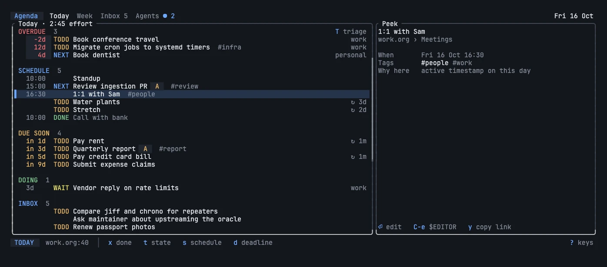
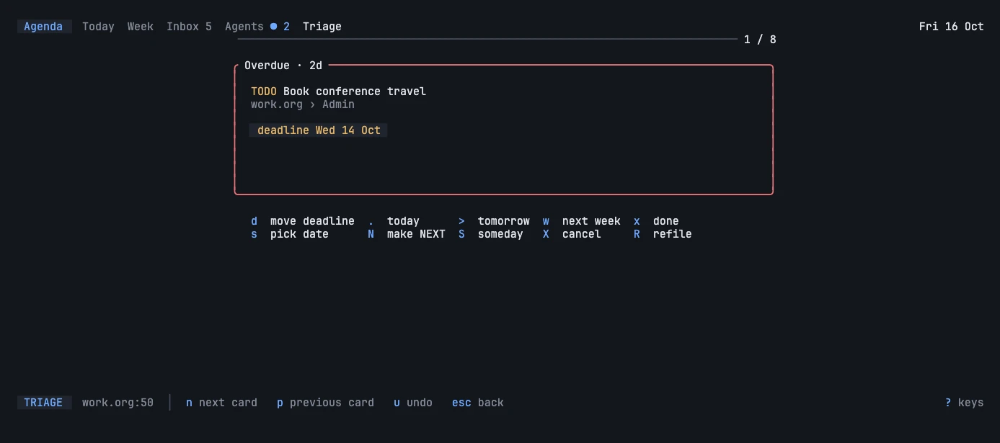
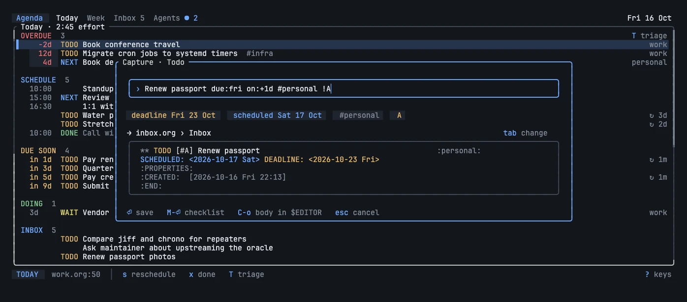
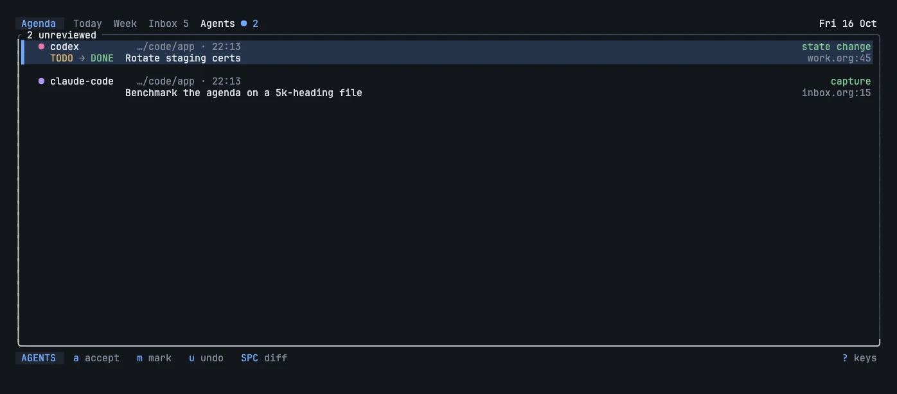
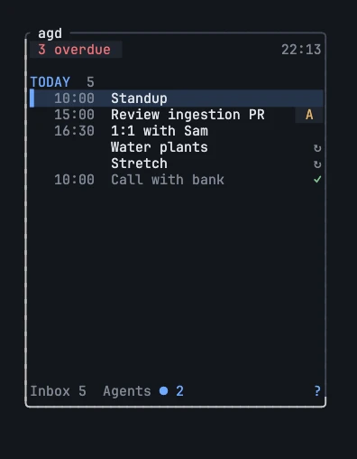
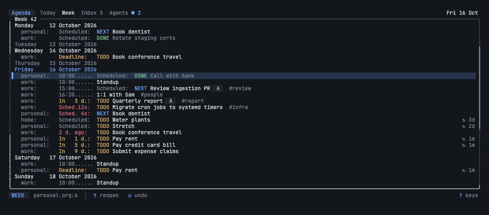
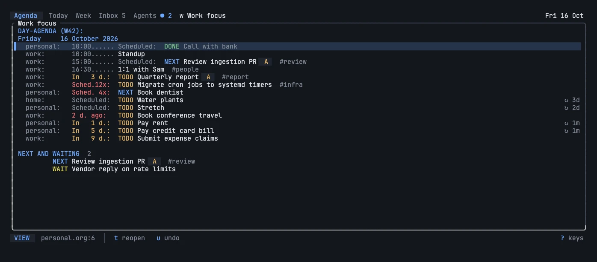
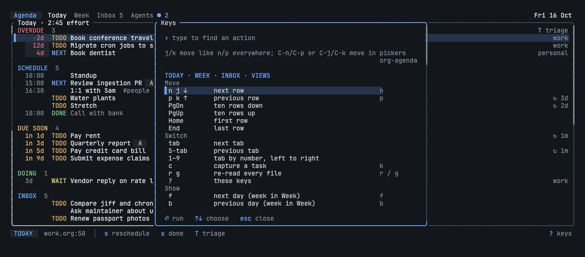

+++
title = "agd"
template = "project.html"
description = "org-agenda for terminals and coding agents"
+++

<!-- Links and images are relative so the same content also serves from
     https://johnnybravo.xyz/projects/agd/. collect.sh copies agd.gif in. -->

agd reads the Org files and settings you already use with Emacs or
nvim-orgmode, shows them in a keyboard-first terminal UI, and lets coding
agents read and write the same tasks over MCP, without changing a byte it was
not asked to change.


- **11** agenda cases identical to Emacs, rows and order
- **15** write cases byte-identical to what Emacs writes
- **0** bytes changed outside the edit you asked for
- **1** binary: the TUI, a narrow pane, a CLI and an MCP server

```sh
cargo install agd --locked
brew install johnnybravo-xyz/agd/agd
nix run github:johnnybravo-xyz/agd
```

[Source](https://github.com/johnnybravo-xyz/agd) ·
[Importing](docs/importing/) · [Compatibility](docs/compatibility/) ·
[Safety](docs/safety/) ·
[Changelog](https://github.com/johnnybravo-xyz/agd/blob/main/agd/CHANGELOG.md)

## Five screens, one for each moment

You glance at today, plan the morning, sweep what slipped, capture mid-flow,
and now check what agents changed. Each has a screen, one key from Today.

**Today** puts sections in the order you act on them: what slipped, what is
timed, what is due, what is in progress, what is new. Slipped stops at three
rows, so the front page never becomes a guilt list. Org's own leaders stay
(`Sched.12x`, countdowns, repeat intervals); `p` peeks at an item and says why
it is listed; `v` swaps in the classic org-agenda day list.



**Triage** (`T`) is the end-of-day sweep: overdue first, then the inbox, one
card at a time and one key per decision: `.` today, `m` tomorrow, `w` next
week, `s` someday, `x` done, `r` refile. Cards show how long an item slipped
and how often it was rescheduled, and suggest Someday after three. `u` undoes
a step, or the whole pass.



**Capture** (`c`) takes one line, `due:fri on:+2d +tag #A`, through your own
capture template and shows the exact Org text before it writes. The first
letter picks the template, like `C-c c t`; `ctrl-e` writes the body in
`$EDITOR`.



**Agent review** (`A`) lists every agent write with who made it, from which
project, as its smallest meaningful diff: a new heading, `TODO → DONE`, a date
move. `a` accepts and writes nothing; `u` undoes it if those bytes are
unchanged.



**The pane** (`agd --pane`) is a 32-column glance beside your agent: timed
items by clock with `▸` on the next one, done items dimmed, slipped collapsed
to a count.



## Your setup keeps working

Point agd at your Emacs or Neovim config once; it reads the files, never your
editor's startup, and writes one flat `config.toml`. In-file syntax always
wins.

- `#+TODO` and `#+SEQ_TODO` lines, logging markers like `WAIT(w@/!)`, and
  `#+STARTUP` log options
- `org-agenda-custom-commands` and nvim-orgmode custom commands become saved
  views, block agendas included
- Capture templates with `%?` `%U` `%T` `%i` `%^{prompt}` `%^g`
- `org-agenda-sorting-strategy`, priorities, deadline warnings and
  `org-tags-column`
- CLOSED, LAST_REPEAT and LOGBOOK lines written exactly as Emacs writes them

```sh
agd setup import ~/.doom.d         # or ~/.config/emacs, ~/.config/nvim
```

Every imported setting is listed with the file and line it came from, and
anything left out with the reason. See [importing](docs/importing/).

Every agenda case runs through a pinned Emacs 30.2 with Org 9.7 and through
agd, and the rows and their order must match. Every write is applied by both
and compared byte for byte. What is not supported (property and regexp
matches, diary sexps, clocking) is reported, never guessed. See
[compatibility](docs/compatibility/).





Keys follow org-agenda wherever it has one: `t` state, `s` and `d` schedule
and deadline, `,` `+` `-` priority, `:` tags, `r` refile, `f` `b` `.` to move
in time, `<` and `/` to filter, `v` and `l` for classic and log mode, `u`
undo. `⏎` edits an entry's title, state, priority, tags and dates in place,
previewing the exact change; `E` opens it in `$EDITOR`. `?` lists them all
next to their org-agenda equivalents.



## Agents work in your agenda, not around it

`agd mcp` is a local stdio server with six tools (`agenda`, `query`,
`capture`, `set_state`, `plan`, `edit`) and an `agenda://today` resource. No
HTTP and no telemetry.

```sh
agd setup install --directory . claude    # or codex, opencode
```

- Every agent write is journaled with the client and project, and waits in
  Agent review
- Captures carry `REPO`, `BRANCH` and a `SOURCE` link back to the line
- `agents.capture_to = "inbox"` lets agents add work without planning your day
- A changed heading is a clean `stale_ref` error, never a lost update

## Lives in tmux and herdr

```sh
tmux split-window -h -l 36 'agd --pane'                   # a glance beside your agent
tmux bind c display-popup -E -w 80 -h 22 'agd capture -i' # capture from anywhere
set -g status-right '#(agd agenda --status)'              # 3 slipped · 7 today · 2 agents
```

Files are watched, so edits from Emacs, nvim or an agent show up as they
happen.

## Org files are your data

Writes patch only their bytes and refuse a stale, ambiguous or duplicate-ID
target. An unsaved Emacs buffer blocks the write; files are re-read under a
lock and replaced atomically, keeping mode and line endings. Undo applies the
journaled inverse only where those bytes are unchanged. agd reads only your
configured roots and never touches the network. See [safety](docs/safety/).

## Try it

```sh
git clone https://github.com/johnnybravo-xyz/agd && cd agd
cargo build --release && AGD=target/release/agd docs/demo/demo.sh
```

The demo runs on sample data and never touches your files.
